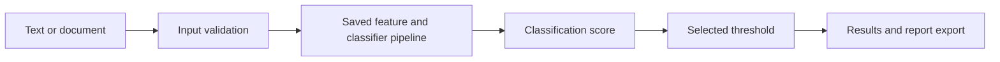

# Text Review

**English text-origin analysis · three trained models · local desktop application**

Text Review compares lexical and writing-style features for classifying human-written and machine-generated English text. It connects the experiments to a local application with document import, model comparison, passage-impact inspection, draft comparison, batch processing, and report export.

This is a portfolio edition of a group NLP course project. It includes the trained models and runtime resources, so the application can run after installing dependencies. Original dataset texts, course submissions, personal details, and machine-specific logs are excluded.

## Run the application

The original application was tested on Windows with Python 3.14.6. Run these commands from the repository root:

```powershell
python -m venv .venv
.venv\Scripts\python.exe -m pip install -r requirements.txt
.venv\Scripts\python.exe -m src.app.desktop
```

On macOS/Linux, use `.venv/bin/python` and install Tkinter if needed. Those platforms have not been verified for this release. Once dependencies are installed, inference and report export run locally without sending documents to an external API.

For a command-line example using a newly written demonstration text:

```powershell
.venv\Scripts\python.exe -m src.app.cli examples/demo.txt report.json --model "Compare All"
```

The example illustrates application behavior; it is not a labelled benchmark. The GUI also supports TXT, DOCX and text-based PDF import, CSV batches, and Word/PDF/JSON export. Scanned PDFs require OCR elsewhere.

## How it works



| Model | Representation | Classifier |
| --- | --- | --- |
| Lexical Features | Word TF-IDF | Logistic regression |
| Writing Style | 32 linguistic measurements | Random forest |
| Combined Features | Word and character TF-IDF plus style features | Logistic regression |

Each `pipeline.joblib` stores the fitted preprocessing and classifier together. `src/app/service.py` verifies the configured file hash, loads the selected pipeline, and runs inference. No retraining occurs when a user analyzes a document. See [model details](MODEL_CARD.md).

## Recorded experiments

The original grouped split contained 2,318 training, 492 validation, and 506 test documents. Related prompts and detected duplicates were kept in the same partition. Baseline hyperparameters were selected using validation macro F1.

| Model | Test accuracy | Test macro F1 | Evaluation scope |
| --- | ---: | ---: | --- |
| Lexical Features | 73.91% | 0.7346 | Frozen baseline, 506 documents |
| Writing Style | 70.36% | 0.7015 | Frozen baseline, 506 documents |
| Combined Features | 77.47% | 0.7708 | Follow-up on the already-used test partition |

These are recorded course experiments, not universal detector performance. The combined model was developed after the baseline test evaluation; its result is not an independent confirmation of improvement. Aggregate records are in [results](results/).

Raising the classification threshold reduces false positives but also misses more machine-generated documents. Scores are model responses, not the percentage of AI-written content. Sentence-deletion highlighting measures prediction sensitivity; it does not establish sentence authorship. The models were evaluated on 50–1,000-word English documents, although the application accepts other non-empty lengths.

## My contribution and team acknowledgements

I proposed the project idea and workflow after discussion with my teammates, and used Codex as a development assistant to lead the initial implementation. My work covered literature research, dataset preparation, baseline and follow-up experiments, application integration, evaluation materials, reproducible packages, and a draft demonstration script.

Thanks to my teammates for subsequent code and documentation revisions, demonstration preparation, and final video production. Individual names and account links are omitted until teammates confirm their preferred public attribution. This is a group project, and this repository does not claim sole authorship of all work.

The public edition adds release documentation, synthetic demonstration input, and a test entry point that identifies the dataset-dependent check. The trained model files and application algorithms are preserved.

## Verification and reproduction

```powershell
.venv\Scripts\python.exe -m scripts.test_public
```

This runs the original test suite, explicitly skipping the one check that requires the excluded frozen training dataset. It includes model inference, input handling, feature checks, and document-export tests. See [verification scope](docs/VERIFICATION.md).

The original training/evaluation source is included for inspection. Exact retraining and the original submission-verification commands require the excluded dataset, manifests, and experiment artifacts; running the desktop app does not. See [reproduction scope](docs/REPRODUCTION.md).

## Sources and use

The experiments use [Beemo](https://github.com/Toloka/beemo) and its [paper](https://aclanthology.org/2025.naacl-long.357/). Style-feature design was informed by [KatFishNet](https://aclanthology.org/2025.acl-long.1030/). The application bundles the NLTK English POS resource and DejaVu font fallbacks with their notices.

See [third-party notices](THIRD_PARTY_NOTICES.md) for source and licensing distinctions. No blanket license is asserted over the group contribution or upstream data. This release is presented for portfolio and research review.
